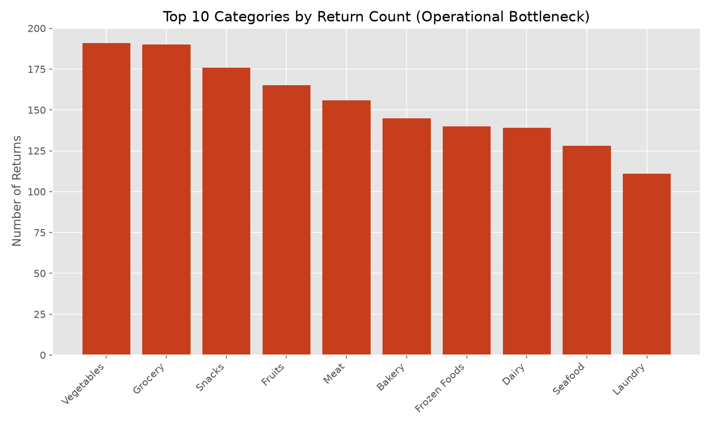

# 🛒 Multi-Store Retail Analytics: From Raw Data to Executive Decisions
An end-to-end data analytics project showcasing a complete pipeline—from automated data cleaning and Exploratory Data Analysis (EDA) to interactive dashboarding in **Apache Superset**.

---

## 📋 Table of Contents
1. [Executive Summary](#1-executive-summary)
2. [Business Requirement & JD Mapping](#2-business-requirement--jd-mapping)
3. [Data Cleaning & ETL Pipeline](#3-data-cleaning--etl-pipeline)
4. [Exploratory Data Analysis (EDA) & Statistics](#4-exploratory-data-analysis-eda--statistics)
5. [Business Insights & Decision Framework](#5-business-insights--decision-framework)
6. [Data Dictionary & Column Reference](#6-data-dictionary--column-reference)
7. [Tech Stack & Reproducibility](#7-tech-stack--reproducibility)

---

## 1. Executive Summary
Based on the analysis of **120,000 transactions** across **325 data points** simulating a multi-branch retail network (200+ centers):
- **Total Revenue:** 11.29M | **Total Profit:** 5.07M | **Overall Margin:** 44.9% | **Average Order Value (AOV):** 94.09
- **Top Margin Driver:** Supplements (51.87%), First Aid (50.38%), and Batteries (48.50%) *(aggregate margin)*.
- **Top Profit (Nominal):** Grocery (253K) and Meat (246K) *(volume play)*.
- **Operational Risk:** Fresh produce (Vegetables & Fruits) accounts for the highest return rates and complaints (cold-chain issue).
- **Customer Health:** 2.3% of customers (2,721) are at high risk of churn (>0.7 score).

---

## 2. Business Requirement & JD Mapping
Targeting the **Data Analyst Associate - Group Service** role at **Seven Retail** (200+ centers across F&B, Education, Healthcare, Lifestyle), this project directly fulfills core analytics responsibilities:
1. **Data Discovery & Exploration:** Automated EDA script uncovering revenue patterns across 120,000 transactions.
2. **Metric Ownership:** Apache Superset Executive Dashboard tracking core financial and operational KPIs with branch-level filtering.
3. **Scalable ETL Pipelines:** Python cleaning pipeline handling missing values, datatype casting, and anomaly detection.
4. **Data Warehouse Modeling:** Clean relational schema with pre-calculated profit metrics loaded into SQLite / PostgreSQL.
5. **Reporting & Dashboards:** Standardized Apache Superset visual framework (`seven-retail-executive-dashboard`).
6. **Data Quality & Governance:** Programmatic data validation checks ensuring 100% financial integrity before reporting.

---

## 3. Data Cleaning & ETL Pipeline
Following the rule of *"Garbage In, Garbage Out — EDA first"*:
- **Initial Audit:** 120,000 rows × 323 columns. Zero duplicate rows, zero negative financial values.
- **Missing Values Imputation:** Categorical nulls set to `"None / Not Applicable"`. `customer_income` imputed using median (250,000).
- **Datetime Casting:** Converted string dates to proper `DATETIME` objects for Superset time-grain drill-downs (Daily, Weekly, Monthly, Yearly).
- **Feature Engineering:** Added `calculated_profit` (`total_amount - cost_of_goods_sold`) and `transaction_year_month` (`YYYY-MM`).
- **Output:** `data/supermarket_cleaned.csv` (120,000 × 325) and `data/superset_local.db`.

---

## 4. Exploratory Data Analysis (EDA) & Statistics
- **Memory Usage:** 1038 MB | **Duplicate Rows:** 0
- **Data Types Breakdown:** 143 string, 103 float64, 77 int64.
- **Key Numeric Averages:** Customer Age 44.8 years, Household Size 3.0, Customer Tenure 95.5 months, Visit Frequency 8.1 visits/month.
- **Payment Mix:** Credit Card (30.2%), Debit Card (25.1%), Cash (19.8%), Mobile Wallet (15.1%), Gift Card / Online Payment (~9.8%).

---

## 5. Business Insights & Decision Framework

### A. Kategori Produk — Profit Margin vs Nominal Profit
| Kategori | Pendapatan | Keuntungan | Margin (%) | Jumlah Transaksi | Keterangan |
|----------|------------|------------|------------|------------------|------------|
| **Supplements** | 152.756 | 79.235 | **51,9%** | 1.521 | Top Margin (%) |
| **First Aid** | 218.498 | 110.079 | **50,4%** | 1.513 | High Margin |
| **Batteries** | 196.203 | 95.164 | **48,5%** | 1.896 | High Margin |
| **Grocery** | 573.786 | 253.434 | 44,2% | 5.734 | Top Nominal Profit |
| **Meat** | 552.706 | 246.306 | 44,6% | 5.865 | Top Nominal Profit |

- **Insights:** Supplements & First Aid offer superior margins (>50%), while Grocery & Meat drive the highest nominal profit (volume play).
- **Action Decision:** Increase shelf-space allocation and cross-selling campaigns for High-Margin categories in top-performing stores.


### B. Operational Bottlenecks: Returns & Complaints
- **Finding:** Overall return rate is **3.06%**. **Vegetables** (191 returns, 187 complaints) and **Fruits** (165 returns, 179 complaints) lead the bottleneck list.
- **Root Cause:** Cold-chain logistics or shelf-life mismanagement at branch level.
- **Action Decision:** Mandate a cold-chain logistics audit for top-10 branches with highest fresh-produce returns to reduce waste by 15%.



### C. Multi-Store Performance & Churn Risk
- **AOV Monitoring:** Average Order Value is **94.09** across store formats.
- **Churn Risk:** **2,721 customers (2.3%)** flagged with high churn risk (>0.7 score).
- **Action Decision:** Trigger automated weekly alerts for Area Managers when a store's AOV drops below Q1, and launch CRM re-engagement vouchers for high-churn customers.

---

## 6. Data Dictionary & Column Reference
Summary of key columns used in decision frameworks:
- `transaction_id`, `store_id`, `customer_id`, `product_id` — Primary & Foreign Keys.
- `total_amount`, `cost_of_goods_sold`, `calculated_profit` — Financial metrics.
- `product_category`, `store_type`, `payment_method` — Categorical dimensions.
- `customer_segment`, `customer_lifetime_value`, `customer_churn_risk` — Customer health metrics.
- `return_flag`, `complaint_category` — Operational bottleneck flags.
- `transaction_datetime` — Temporal dimension for Superset time-grain aggregation.

---

## 7. Tech Stack & Reproducibility
- **Python / Pandas / NumPy:** Automated profiling, cleaning, and feature engineering.
- **Apache Superset (Docker, port 8088):** Interactive executive dashboarding via REST API automation.
- **SQLite / Relational Modeling:** Queryable analytical storage.
- **Reproduce in 3 Commands:**
  ```bash
  python src/eda_analysis.py
  python src/data_cleaning.py
  python src/generate_charts.py
  ```

---
