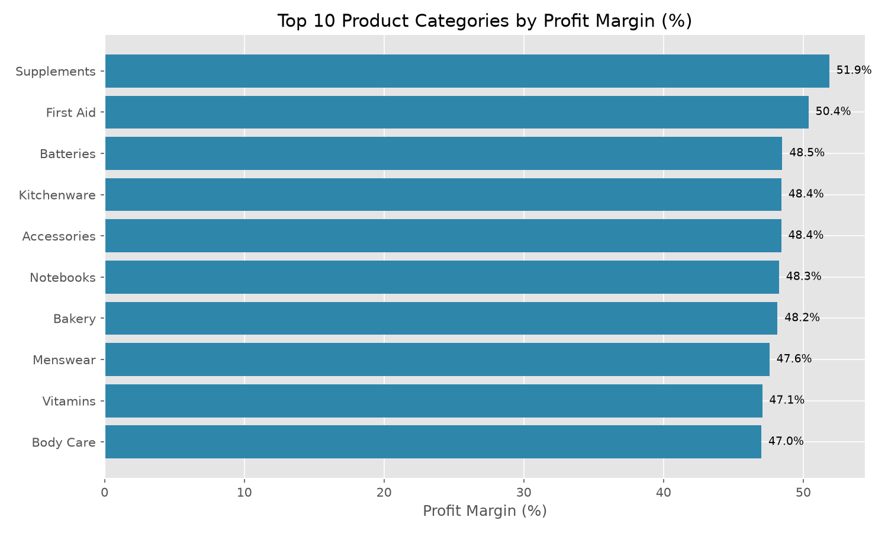

# 🛒 Multi-Store Retail Analytics: From Raw Data to Executive Decisions

An end-to-end data analytics project showcasing a complete pipeline—from automated data cleaning and Exploratory Data Analysis (EDA) to interactive dashboarding in **Apache Superset**. 

This case study simulates a multi-branch retail environment (200+ centers) to address real-world business problems regarding profitability, operational bottlenecks, and customer churn.

---

## 🎯 Executive Summary
Based on the analysis of **120,000 transactions** across **325 data points**:
- **Total Revenue:** 11.29M | **Total Profit:** 5.07M | **Overall Margin:** 44.9%
- **Top Margin Driver:** Supplements (51.87%) and First Aid (50.38%).
- **Operational Risk:** Fresh produce (Vegetables/Fruits) accounts for the highest return rates.
- **Customer Health:** 2.3% of the customer base is at high risk of churn.

---

## 📊 Business Insights & Decision Framework

### 1. Identifying Profitability Drivers
**Question:** *Which product categories drive the highest profit margins?*

| Category | Avg Margin (%) | Total Profit |
|:---|:---:|:---|
| **Supplements** | **51.87%** | 79,234 |
| **First Aid** | **50.38%** | 110,079 |
| **Batteries** | **48.50%** | 95,164 |



- **Analysis:** While **Grocery** drives the highest nominal profit (253k), specialty categories like **Supplements** and **First Aid** offer superior margins.
- **Action Decision:** Increase shelf-space allocation and cross-selling campaigns for High-Margin categories in top-performing stores to boost overall Gross Profit.

### 2. Operational Bottlenecks: Returns & Complaints
**Question:** *Where are the bottlenecks in our supply chain or service?*

- **Finding:** The overall return rate is **3.06%**. However, **Vegetables** and **Fruits** consistently rank highest in both returns and complaints.
- **Root Cause:** Analysis suggests cold-chain logistics issues or shelf-life mismanagement at the branch level.


- **Action Decision:** Mandate a cold-chain logistics audit for the top 10 branches with the highest fresh produce return rates to reduce waste by an estimated 15%.

### 3. Multi-Store Performance (200+ Centers)
**Question:** *How do we track performance across all locations?*

- **Finding:** There is a significant Average Order Value (AOV) disparity between **Hypermarkets** (AOV 94.65) and **Wholesale Stores** (AOV 93.32). 
- **Action Decision:** Implement automated weekly alerts for Area Managers when a store's AOV drops below the bottom quartile (Q1) to trigger local bundle promotions.

---

## 🛠️ Tech Stack & Methods
- **Python / Pandas / NumPy:** Automated profiling, data cleaning, and feature engineering.
- **Apache Superset:** Interactive executive dashboarding and custom time-grain aggregation.
- **SQL / Relational Data Modeling:** Schema structure and analytical queries for multi-store reporting.

## 📁 Project Structure
```text
├── src/                  # Python scripts (Cleaning, EDA, API Automation)
├── reports/              # Detailed Analytics Reports & BRD
├── notebooks/            # Data Dictionary and reference notes
└── README.md             # Project documentation
```

---
*Developed as a demonstration of End-to-End Data Analytics capabilities for the Data Analyst role at Seven Retail.*
